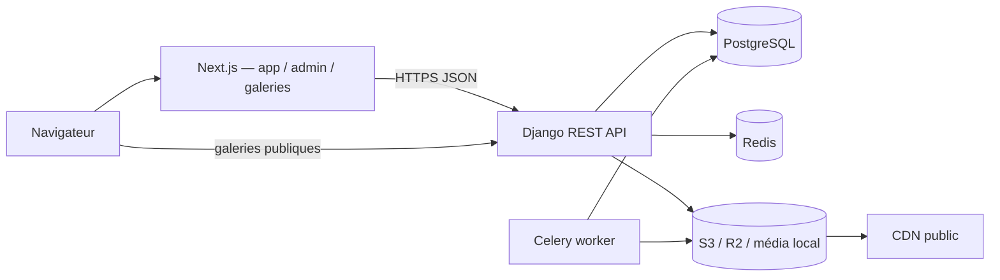

# Pixeo — Architecture cible

> **Statut : référence validée ; fondation A4 et authentification A5 réalisées.**
> PostgreSQL, la migration initiale `accounts`, Django Admin, le health check
> base et les endpoints d'authentification sont en place. Les modèles métier et
> les endpoints métier seront ajoutés dans les lots suivants. Ce document décrit
> la cible Django/DRF validée ; il ne remplace pas
> `DEVELOPMENT_PROGRESS.md`, qui suit l'avancement réel.

## 1. Vue d'ensemble

Pixeo est un SaaS de galeries photo pour photographes.

| Couche | Technologie | Rôle |
|--------|-------------|------|
| Frontend | Next.js 16 (App Router), React, TypeScript | Dashboard photographe, galeries publiques, console admin |
| API | Django 5.2 LTS + Django REST Framework | Métier, authentification, permissions, quotas |
| Base | PostgreSQL 17.6 (développement et production), SQLite en mémoire (tests) | Données relationnelles |
| Cache / files | Redis + Celery | Cache, rate limiting, tâches asynchrones |
| Fichiers | Stockage local (dev) / S3 ou Cloudflare R2 (prod) | Originaux et dérivés |
| Reverse proxy | Nginx ou équivalent | TLS, sous-domaines, headers |



## 2. Multi-tenant et résolution du photographe

Le tenant est le **photographe** (`accounts.User`). Il n'existe pas de modèle
`Tenant` séparé.

- Clé de tenant : `User.branding_username`, unique et immuable pendant une session.
- En production, le sous-domaine détermine le tenant :
  `https://{username}.pixeo.com/`.
- Les URLs publiques de galerie incluent le username pour une résolution explicite
  côté API : `https://api.pixeo.com/api/v1/public/{username}/galleries/{slug}/`.
- Le domaine de base est configurable via `PIXEO_BASE_DOMAIN`.
- Les URLs plateforme sont séparées :
  - application photographe : `https://app.pixeo.com/`
  - console admin : `https://admin.pixeo.com/`
  - API : `https://api.pixeo.com/`
  - espace public : `https://{username}.pixeo.com/`
  - galerie publique : `https://{username}.pixeo.com/{gallery-slug}/`
  - lien privé pre-release : `https://{username}.pixeo.com/p/{share_token}/`

> La disponibilité de `pixeo.com`, le DNS wildcard et les certificats TLS ne sont
> pas vérifiés à ce stade. Ils ne bloquent pas le développement local.

## 3. Applications Django

| App | Responsabilité |
|-----|----------------|
| `accounts` | Utilisateur custom, authentification, rôles, statuts, sessions JWT |
| `billing` | Plans, abonnements, historique de facturation (sans paiement V1) |
| `studios` | Branding, homepage publique, préférences du photographe |
| `galleries` | Collections/galeries, sets, photos, liaisons, accès, activités |
| `contacts` | Contacts clients et historique de partage |
| `marketing` | Campagnes email (V1 : stockage/brouillon, pas d'envoi réel) |
| `platform` | Administration plateforme, paramètres globaux, audit |
| `api` | Fondations DRF : routeur versionné, enveloppes, erreurs, pagination, permissions de base, camelCase |
| `common` | Mixins, permissions, pagination, erreurs, stockage, utilitaires |

Règles :

- Aucune logique métier dans les vues au-delà de l'orchestration.
- Les querysets sont toujours filtrés par tenant.
- Les permissions sont explicites et testées.
- Les opérations sensibles utilisent `transaction.atomic()`.

### Structure backend en place (A5)

```text
backend/
├── config/
│   ├── settings/
│   │   ├── base.py           # configuration commune, DRF, JWT, CSRF, CORS
│   │   ├── development.py    # local, DEBUG, docs publiques
│   │   └── production.py     # garde-fous PostgreSQL, HTTPS, cookies, docs admin
│   ├── urls.py               # admin, health, schéma/docs, routeur versionné
│   ├── views.py              # health check Django + PostgreSQL
│   ├── tests/                # tests du health check
│   ├── asgi.py
│   └── wsgi.py
├── apps/
│   ├── accounts/
│   │   ├── models.py         # User, UserManager, rôles, statuts
│   │   ├── authentication.py # PixeoJWTAuthentication, PixeoSessionAuthentication
│   │   ├── schema.py         # extensions OpenAPI JWT/session
│   │   ├── validators.py     # branding_username
│   │   ├── admin.py          # Django Admin User
│   │   ├── forms.py          # formulaires admin sécurisés
│   │   ├── auth/
│   │   │   ├── urls.py       # routes /api/v1/auth/
│   │   │   ├── views.py      # login, refresh, logout, me, csrf
│   │   │   ├── serializers.py
│   │   │   ├── services.py   # vérification, rotation, révocation
│   │   │   ├── cookies.py    # cookie refresh HttpOnly
│   │   │   ├── csrf.py       # vérification CSRF ciblée
│   │   │   ├── throttles.py  # login/refresh
│   │   │   └── exceptions.py # codes d'auth stables
│   │   ├── migrations/
│   │   │   └── 0001_initial.py
│   │   └── tests/
│   └── api/
│       ├── serializers.py    # PixeoSerializer, conversion camelCase
│       ├── pagination.py     # page/page_size, enveloppe items/pageSize
│       ├── exceptions.py     # gestion centralisée des erreurs DRF
│       ├── permissions.py    # IsPhotographer, IsPlatformAdmin, statut courant
│       ├── views.py          # racine API versionnée
│       ├── urls.py           # routeur DRF + routes auth
│       └── tests/
├── docker-compose.yml        # PostgreSQL 17.6 local
├── manage.py
├── requirements.txt
├── requirements-dev.txt
├── pytest.ini
└── .env.example
```

Principes appliqués :

- `DJANGO_SETTINGS_MODULE` sélectionne `development` ou `production` ; `manage.py`
  utilise `development` par défaut, WSGI/ASGI utilisent `production` par défaut.
- Aucun secret n'est codé en dur : `DJANGO_SECRET_KEY`, base, cache et stockage
  viennent de l'environnement.
- La production refuse `DEBUG=True`, SQLite, l'absence de `ALLOWED_HOSTS`, de
  `CSRF_TRUSTED_ORIGINS` et de cache Redis.
- PostgreSQL 17.6 est fourni en local par `backend/docker-compose.yml`, avec un
  volume persistant et un healthcheck. La migration initiale `accounts` est
  versionnée et appliquée ; les migrations font partie du code source.
- CORS et CSRF sont configurés séparément. Aucun wildcard CORS global n'est
  activé. En production, les origines autorisées sont déclarées explicitement et
  les sous-domaines tenants ne reçoivent pas d'accès CORS avec credentials.
- Les cookies de refresh et CSRF restent host-only (aucun `Domain` global). Le
  refresh est limité au chemin `/api/v1/auth/`, `SameSite=Lax`, `Secure` en
  production. Le cookie CSRF est lisible par le frontend, qui préfère toutefois
  le jeton JSON retourné par `/api/v1/auth/csrf/`.
- Argon2 est le hasher privilégié. SimpleJWT fournit l'access token et le refresh
  token ; `token_blacklist` est installé et applique la rotation/révocation.
- `PixeoJWTAuthentication` et `PixeoSessionAuthentication` rechargent le compte
  depuis la base à chaque requête et refusent un compte suspendu ou désactivé.
- Le package `apps.accounts.auth` centralise les vues, serializers, cookies,
  services de rotation, vérification CSRF, throttles et exceptions d'auth.
- Django Admin expose le modèle `User` avec recherche, filtres rôle/statut,
  formulaire de création sécurisé et hash de mot de passe en lecture seule.
- `User.clean()` impose qu'un superutilisateur conserve
  `role=platform_admin` ; les formulaires admin utilisent `full_clean()` et ne
  permettent donc pas de contourner cet invariant.
- Le health check `/api/v1/health/` exécute `SELECT 1` et renvoie HTTP 503 lorsque
  PostgreSQL est indisponible, sans exposer les détails de connexion.
- La suspension métier (`is_suspended`) est distincte de `is_active`. Les deux
  statuts sont contrôlés à la connexion, au refresh et à chaque requête
  authentifiée, afin qu'un ancien token ne contourne pas une suspension.
- Le stockage local/S3-R2 est sélectionné par `STORAGE_BACKEND`, sans impact sur
  la logique métier.
- L'API est versionnée par `URLPathVersioning` ; seule `v1` est autorisée. Le
  routeur `apps.api.urls` monte les routes `/api/v1/auth/` et reste extensible
  pour les futurs endpoints métier.
- Les réponses de succès utilisent `{"ok": true, "data": ...}` ; les erreurs
  utilisent `{"ok": false, "error", "code", "details"}` avec des codes stables.
- La pagination accepte `page` et `page_size`, avec 20 éléments par défaut et
  100 maximum ; la réponse expose `pageSize` en camelCase.
- `PixeoSerializer` et `PixeoModelSerializer` convertissent récursivement les
  clés en camelCase, y compris pour les erreurs de validation.
- Les permissions de base distinguent `IsPhotographer`, `IsPlatformAdmin` et les
  vues publiques explicites (`AllowAny`). Les permissions de rôle vérifient aussi
  le statut courant du compte. L'isolation multi-tenant sera ajoutée dans les
  lots métier.
- La documentation OpenAPI est exposée via `schema`, Swagger UI et ReDoc ; elle
  est publique en développement et réservée aux administrateurs en production.
  Les schémas de sécurité `jwtAuth` et `cookieAuth` sont documentés.

## 4. Modèle de données cible

Les noms Python sont en `snake_case` ; les serializers exposent du `camelCase`.

### `accounts.User`

Utilisateur custom défini **avant la première migration**. Le modèle `User` étend
`AbstractUser`, mais remplace le `username` Django par l'e-mail comme identifiant
de connexion (`USERNAME_FIELD = "email"`).

| Champ | Type | Notes |
|-------|------|-------|
| `id` | UUID | PK |
| `email` | email unique | Identifiant de connexion, normalisé en minuscules |
| `first_name`, `last_name` | char | Nom du photographe ; le nom affiché et les initiales sont dérivés |
| `branding_username` | slug unique | Clé de tenant et sous-domaine, 1–63 caractères |
| `role` | choix | `photographer` / `platform_admin` |
| `is_active` | bool | Compte actif/inactif Django |
| `is_suspended` | bool | Suspension métier explicite |
| `suspended_at` | datetime nullable | Horodatage de suspension |
| `is_staff`, `is_superuser` | bool | Compatibilité Django admin |
| `created_at`, `updated_at` | datetime | Dates de création et de modification |
| `date_joined` | datetime | Champ natif `AbstractUser` conservé |

`status` est une propriété dérivée (`active`, `inactive`, `suspended`), pas un
champ dupliqué. `username` n'existe pas.

Règles de `branding_username` :

- normalisation en minuscules et suppression des espaces de bord avant validation ;
- label DNS sûr : `[a-z0-9-]`, pas de tiret initial/final, longueur maximale 63 ;
- noms réservés refusés (`app`, `admin`, `api`, `www`, `cdn`, `mail`, `static`,
  `media`, etc.) ;
- validateur serveur dans `apps/accounts/validators.py` et contrainte
  `unique=True` en base ;
- normalisation appliquée par `clean_fields()` et `save()`, donc à la création
  comme à la modification ;
- validation explicite via `full_clean()` dans le manager de création ; les
  serializers des lots métier déclencheront la validation des modifications ;
- résolution d'authentification par e-mail insensible à la casse via
  `UserManager.get_by_natural_key()`.

**Pas de champ `plan` sur `User`.** Le plan actif est porté par `Subscription`.
`storage_used_bytes` n'est pas créé en A5 ; il sera ajouté avec la logique de
quota, sans dupliquer le plan.

La migration initiale `accounts.0001_initial` est versionnée et appliquée sur
PostgreSQL. Elle crée `accounts_user` avec la clé primaire UUID et les
contraintes `UNIQUE (email)` et `UNIQUE (branding_username)`. Aucun modèle métier
n'est créé en A5.

Django Admin applique les règles du modèle : le formulaire de création hash le
mot de passe, le hash n'est jamais éditable, et `suspended_at` est maintenu en
cohérence avec `is_suspended`.

### `billing.Plan` et `billing.Subscription`

- `Plan` : catalogue éditable par l'admin (`free`, `starter`, `pro`, `studio`),
  prix FCFA, quota de stockage, fonctionnalités, ordre, actif.
- **Aucune limite de nombre de galeries**, quel que soit le plan. Seul le stockage
  est limité.
- `Subscription` est la **source de vérité** du plan actif :
  `user`, `plan`, `status`, dates de période, `cancel_at_period_end`.
- En V1, le changement de plan est réservé à l'admin plateforme. Aucun paiement
  Stripe n'est intégré.

### `studios.Branding` et `studios.HomepageSettings`

- `Branding` : 1:1 avec `User` — logo, favicon, filigrane, domaine custom (V1 :
  stocké mais non routé).
- `HomepageSettings` : 1:1 avec `User` — activation, biographie, nom de marque,
  mot de passe **hashé**.
- Les galeries `pre-release` ne sont jamais listées sur la homepage.

### `galleries`

| Modèle | Rôle |
|--------|------|
| `Collection` | Galerie client (le frontend parle de « collection ») |
| `CollectionSet` | Set ordonné à l'intérieur d'une collection |
| `Photo` | Fichier de la bibliothèque du photographe |
| `CollectionPhoto` | Liaison N:N photo ↔ collection, avec ordre et set optionnel |
| `FavoriteList` | Liste de favoris configurée par le photographe |
| `GalleryActivity` | Journal d'activité : vue, téléchargement, favori, note |

Points clés :

- Une photo appartient à la **bibliothèque du photographe** (`Photo.owner`) et peut
  être rattachée à **plusieurs collections** via `CollectionPhoto`.
- Retirer une photo d'une collection supprime la ligne `CollectionPhoto`, **jamais**
  le fichier de bibliothèque.
- Supprimer une collection ne supprime **jamais** les photos utilisées ailleurs.
- `Collection` porte notamment : `slug`, `status` (`published`, `draft`, `hidden`,
  `pre-release`), visibilité homepage, mot de passe hashé, code d'accès client
  exclusif hashé, options de téléchargement, PIN de téléchargement hashé, favoris,
  notes, `share_token`, dates d'expiration.
- Contrainte d'unicité : `(owner, slug)`.
- `share_token` est unique et imprévisible ; il sert au lien privé pre-release.
- L'expiration est vérifiée **côté serveur**, à chaque accès.

### Autres

- `contacts.Contact`, `contacts.EmailShare` : contacts et historique de partage.
- `marketing.Campaign` : campagnes (V1 : brouillon/stockage, pas d'envoi réel).
- `platform.*` : paramètres globaux et journal d'audit admin.

## 5. Authentification et sessions

### Photographe / admin

- Access token JWT de courte durée (10 minutes par défaut), conservé **en
  mémoire** côté navigateur et envoyé via `Authorization: Bearer`.
- Refresh token dans un cookie **HttpOnly**, `SameSite=Lax`, `Secure` en
  production, host-only et limité au chemin `/api/v1/auth/`. Il n'est jamais
  retourné dans le JSON.
- Rotation à chaque refresh : l'ancien refresh R1 est blacklisté. La déconnexion
  blackliste le refresh courant et supprime le cookie.
- La réutilisation de R1 est refusée avec `TOKEN_REVOKED`. SimpleJWT blackliste
  le jeton individuel, pas sa famille : R2 reste valide après la détection du
  rejeu. Une révocation de famille n'est pas implémentée en A5.
- Évolution proportionnée si ce besoin devient critique : ajouter un identifiant
  de session (`sid`) commun aux refresh d'une même connexion, le stocker dans un
  modèle de session et marquer la session révoquée dès qu'un refresh déjà
  blacklisté est rejoué. Compromis : une écriture/lookup supplémentaire par
  refresh, une politique de nettoyage, la gestion des courses et une migration
  des jetons. Cette complexité n'est pas justifiée pour A5 ; la blacklist
  individuelle, la durée courte de l'access token et le contrôle du statut du
  compte couvrent le besoin actuel.
- Protection CSRF sur `login`, `refresh` et `logout` via `X-CSRFToken`. Le jeton
  est obtenu via `GET /api/v1/auth/csrf/`. Le login crée une session, il est donc
  protégé contre le Login CSRF même s'il ne consomme pas encore le cookie de
  refresh. Aucune désactivation globale de CSRF.
- Le login n'accepte que `application/json` ; les formulaires HTML classiques
  (`form-urlencoded`/`multipart`) et les corps `text/plain` ne peuvent pas créer
  de session.
- CORS limité aux origines Pixeo explicitement connues, avec credentials. En
  production, aucun wildcard de sous-domaines tenants n'est activé.
- Les contrôles `is_active` et `is_suspended` sont refaits à chaque requête
  authentifiée, pas seulement au login.
- Les sessions photographe et l'accès public aux galeries sont **séparés** : un
  visiteur de galerie ne reçoit jamais de JWT photographe.
- Limite connue : un access token déjà émis reste valide jusqu'à son expiration
  après un logout ; il n'y a pas de révocation immédiate des access tokens dans
  ce lot. La durée courte limite cette fenêtre.

### Accès public aux galeries

- Résolution du tenant par username (URL ou sous-domaine).
- Galerie `published` : accès selon les règles de la collection.
- Galerie protégée : vérification serveur du mot de passe hashé, puis session
  d'accès limitée à cette galerie.
- Galerie `pre-release` : accessible uniquement via `share_token`, jamais listée
  sur la homepage, expiration vérifiée côté serveur.
- Accès client exclusif : code dédié généré par le photographe, stocké hashé.
- PIN de téléchargement : hashé, vérifié côté serveur, tentatives limitées.
- `?preview=1` ne contourne **jamais** les contrôles : la prévisualisation owner
  exige une authentification photographe et vérifie la propriété de la collection.

### Secrets

Mots de passe de galerie, mot de passe de homepage, PIN de téléchargement et code
d'accès client sont **hashés** (hashers Django, Argon2 privilégié). Aucune API ne
les retourne en clair. Une procédure de réinitialisation est fournie ; il n'existe
pas de récupération.

## 6. Stockage des images

Abstraction via le backend de stockage Django :

- **Développement** : upload multipart vers Django, fichiers dans `MEDIA_ROOT`.
- **Production** : S3 ou Cloudflare R2 via `django-storages`, URLs signées.
- Les clés de stockage sont stables et ne dépendent pas du provider.
- La logique métier (quotas, collections, permissions) ne change pas selon le
  backend.
- Les dérivés (thumbnail, web, haute résolution) sont générés par des tâches
  Celery ; les originaux restent la source.

## 7. API

- Préfixe : `/api/<version>/`, avec `v1` comme seule version autorisée en A5.
- Réponses de succès : `{"ok": true, "data": ...}`.
- Erreurs uniformes : `{"ok": false, "error", "code", "details"}` ; codes
  stables, détails de validation conservés, aucune fuite interne.
- Pagination standard : `page`, `page_size` (20 par défaut, 100 maximum), réponse
  `items`, `total`, `page`, `pageSize`.
- Conversion `camelCase` centralisée dans les serializers.
- Authentification : access JWT Bearer, refresh cookie HttpOnly, rotation,
  blacklist et CSRF sur login/refresh/logout. Routes sous `/api/v1/auth/`.
- Permissions de base : `IsPhotographer`, `IsPlatformAdmin`, `AllowAny` explicite
  pour les vues publiques. Les permissions de rôle contrôlent aussi le statut.
- Documentation OpenAPI générée avec `drf-spectacular` : `/api/v1/schema/`,
  `/api/v1/docs/` (Swagger UI) et `/api/v1/redoc/`. Les schémas `jwtAuth` et
  `cookieAuth` sont déclarés.
- Health check `/api/v1/health/` : vérifie PostgreSQL et renvoie HTTP 503 si la
  base est indisponible. Son format historique est conservé.
- Détail du contrat : [`API_DOCUMENTATION.md`](API_DOCUMENTATION.md).

## 8. Sécurité

- Isolation stricte par tenant dans les vues, querysets, serializers et permissions.
- Aucun accès à un objet d'un autre photographe, même avec un UUID valide.
- Rate limiting sur connexion et refresh (5/min et 30/min par défaut), ainsi que
  sur les futurs mots de passe de galerie, codes d'accès et PIN.
- Transactions pour inscription, changement de plan, suppression de collection,
  retrait de photos, création de partage.
- Validation des uploads : type MIME, taille, dimensions, nom de fichier.
- Pas de succès simulé : une fonctionnalité non configurée renvoie une erreur
  explicite (`not_configured`) ou est désactivée.
- Journalisation des actions admin sensibles.
- Aucun mot de passe, hash, access token ou refresh token n'est journalisé ou
  renvoyé dans les réponses. Les erreurs d'authentification sont génériques.
- CSRF obligatoire sur les opérations qui créent ou consomment le cookie de
  refresh (`login`, `refresh`, `logout`) ; CORS restrictif avec credentials ;
  cookies host-only par défaut. CORS ne remplace pas CSRF.

## 9. Hors périmètre V1

- Envoi réel d'emails (les emails sont journalisés/console en développement).
- Stripe, paiements et facturation réelle.
- Boutique / vente de tirages.
- Intégrations externes.
- Routage des domaines custom (le champ est stocké, pas routé).
- Application mobile native.

## 10. Déploiement cible

| Composant | Cible |
|-----------|-------|
| Frontend | Vercel ou équivalent |
| API | Serveur WSGI (Gunicorn) derrière Nginx |
| Base | PostgreSQL managé |
| Cache / broker | Redis managé |
| Worker | Celery |
| Fichiers | S3 / R2 + CDN |
| DNS | wildcard `*.pixeo.com` + `api` + `app` + `admin` |
| TLS | Certificats wildcard / automatiques |

## 11. Migration depuis la démo

La démo frontend utilise `localStorage`. La bascule se fera en **Phase E**, après
validation du backend :

1. Remplacer `lib/gallery-context.tsx` par des appels API.
2. Conserver les écrans et mapper les types `camelCase`.
3. Servir les galeries publiques depuis l'API (pas `localStorage`).
4. Adapter l'UI aux secrets hashés (création/réinitialisation, jamais affichage).
5. Supprimer les données de démonstration du chemin de production.

## 12. Documentation

- [`ARCHITECTURE.md`](ARCHITECTURE.md) — ce document
- [`API_DOCUMENTATION.md`](API_DOCUMENTATION.md) — contrat API
- [`DEVELOPMENT_PROGRESS.md`](DEVELOPMENT_PROGRESS.md) — avancement par lot
- [`LOCAL_DEVELOPMENT.md`](LOCAL_DEVELOPMENT.md) — sous-domaines et environnement local
- [`LAUNCH.md`](LAUNCH.md) — checklist de lancement (à actualiser en Phase E)
