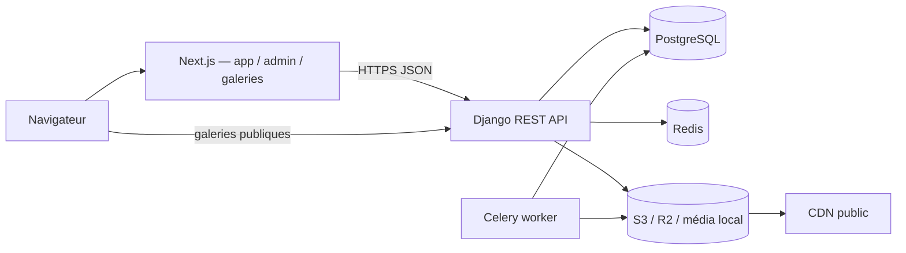

# Pixeo — Architecture cible

> **Statut : référence validée, lot A1.**
> Le backend n'est pas encore implémenté. Ce document décrit la cible Django/DRF
> validée ; il ne remplace pas `DEVELOPMENT_PROGRESS.md`, qui suit l'avancement réel.

## 1. Vue d'ensemble

Pixeo est un SaaS de galeries photo pour photographes.

| Couche | Technologie | Rôle |
|--------|-------------|------|
| Frontend | Next.js 16 (App Router), React, TypeScript | Dashboard photographe, galeries publiques, console admin |
| API | Django 5.2 LTS + Django REST Framework | Métier, authentification, permissions, quotas |
| Base | PostgreSQL (production), SQLite (développement) | Données relationnelles |
| Cache / files | Redis + Celery | Cache, rate limiting, tâches asynchrones |
| Fichiers | Stockage local (dev) / S3 ou Cloudflare R2 (prod) | Originaux et dérivés |
| Reverse proxy | Nginx ou équivalent | TLS, sous-domaines, headers |

## 2. Multi-tenant et résolution du photographe

Le tenant est le **photographe** (`accounts.User`). Il n'existe pas de modèle
`Tenant` séparé.

- Clé de tenant : `User.branding_username`, unique et immuable pendant une session.
- En production, le sous-domaine détermine le tenant :
  `https://{username}.pixeo.com/`.
- Les URLs publiques de galerie incluent le username pour une résolution explicite
  côté API : `https://api.pixeo.com/api/v1/public/{username}/galleries/{slug}/`.
- Le domaine de base est configurable via `PIXEO_BASE_DOMAIN`.
- Les URLs plateforme sont séparées :
  - application photographe : `https://app.pixeo.com/`
  - console admin : `https://admin.pixeo.com/`
  - API : `https://api.pixeo.com/`
  - espace public : `https://{username}.pixeo.com/`
  - galerie publique : `https://{username}.pixeo.com/{gallery-slug}/`
  - lien privé pre-release : `https://{username}.pixeo.com/p/{share_token}/`

> La disponibilité de `pixeo.com`, le DNS wildcard et les certificats TLS ne sont
> pas vérifiés à ce stade. Ils ne bloquent pas le développement local.

## 3. Applications Django

| App | Responsabilité |
|-----|----------------|
| `accounts` | Utilisateur custom, authentification, rôles, statuts, sessions JWT |
| `billing` | Plans, abonnements, historique de facturation (sans paiement V1) |
| `studios` | Branding, homepage publique, préférences du photographe |
| `galleries` | Collections/galeries, sets, photos, liaisons, accès, activités |
| `contacts` | Contacts clients et historique de partage |
| `marketing` | Campagnes email (V1 : stockage/brouillon, pas d'envoi réel) |
| `platform` | Administration plateforme, paramètres globaux, audit |
| `common` | Mixins, permissions, pagination, erreurs, stockage, utilitaires |

Règles :

- Aucune logique métier dans les vues au-delà de l'orchestration.
- Les querysets sont toujours filtrés par tenant.
- Les permissions sont explicites et testées.
- Les opérations sensibles utilisent `transaction.atomic()`.

## 4. Modèle de données cible

Les noms Python sont en `snake_case` ; les serializers exposent du `camelCase`.

### `accounts.User`

Utilisateur custom créé **avant la première migration**.

| Champ | Type | Notes |
|-------|------|-------|
| `id` | UUID | PK |
| `email` | email unique | Identifiant de connexion |
| `name` | char | Nom affiché |
| `initials` | char | Dérivé, stocké pour l'UI |
| `role` | choix | `photographer` / `platform_admin` |
| `status` | choix | `active` / `suspended` |
| `branding_username` | slug unique | Clé de tenant et sous-domaine |
| `storage_used_bytes` | bigint | Agrégat cache, recalculable |
| `is_active`, `is_staff` | bool | Compatibilité Django admin |
| `created_at`, `updated_at` | datetime | |

**Pas de champ `plan` sur `User`.** Le plan actif est porté par `Subscription`.

### `billing.Plan` et `billing.Subscription`

- `Plan` : catalogue éditable par l'admin (`free`, `starter`, `pro`, `studio`),
  prix FCFA, quota de stockage, fonctionnalités, ordre, actif.
- **Aucune limite de nombre de galeries**, quel que soit le plan. Seul le stockage
  est limité.
- `Subscription` est la **source de vérité** du plan actif :
  `user`, `plan`, `status`, dates de période, `cancel_at_period_end`.
- En V1, le changement de plan est réservé à l'admin plateforme. Aucun paiement
  Stripe n'est intégré.

### `studios.Branding` et `studios.HomepageSettings`

- `Branding` : 1:1 avec `User` — logo, favicon, filigrane, domaine custom (V1 :
  stocké mais non routé).
- `HomepageSettings` : 1:1 avec `User` — activation, biographie, nom de marque,
  mot de passe **hashé**.
- Les galeries `pre-release` ne sont jamais listées sur la homepage.

### `galleries`

| Modèle | Rôle |
|--------|------|
| `Collection` | Galerie client (le frontend parle de « collection ») |
| `CollectionSet` | Set ordonné à l'intérieur d'une collection |
| `Photo` | Fichier de la bibliothèque du photographe |
| `CollectionPhoto` | Liaison N:N photo ↔ collection, avec ordre et set optionnel |
| `FavoriteList` | Liste de favoris configurée par le photographe |
| `GalleryActivity` | Journal d'activité : vue, téléchargement, favori, note |

Points clés :

- Une photo appartient à la **bibliothèque du photographe** (`Photo.owner`) et peut
  être rattachée à **plusieurs collections** via `CollectionPhoto`.
- Retirer une photo d'une collection supprime la ligne `CollectionPhoto`, **jamais**
  le fichier de bibliothèque.
- Supprimer une collection ne supprime **jamais** les photos utilisées ailleurs.
- `Collection` porte notamment : `slug`, `status` (`published`, `draft`, `hidden`,
  `pre-release`), visibilité homepage, mot de passe hashé, code d'accès client
  exclusif hashé, options de téléchargement, PIN de téléchargement hashé, favoris,
  notes, `share_token`, dates d'expiration.
- Contrainte d'unicité : `(owner, slug)`.
- `share_token` est unique et imprévisible ; il sert au lien privé pre-release.
- L'expiration est vérifiée **côté serveur**, à chaque accès.

### Autres

- `contacts.Contact`, `contacts.EmailShare` : contacts et historique de partage.
- `marketing.Campaign` : campagnes (V1 : brouillon/stockage, pas d'envoi réel).
- `platform.*` : paramètres globaux et journal d'audit admin.

## 5. Authentification et sessions

### Photographe / admin

- Access token JWT courte durée, conservé **en mémoire** côté navigateur.
- Refresh token dans un cookie **HttpOnly**, `Secure` en production, `SameSite`
  adapté, avec rotation et blacklist.
- Protection CSRF sur les requêtes mutantes (double-submit token).
- CORS limité aux origines Pixeo connues.
- Les sessions photographe et l'accès public aux galeries sont **séparés** : un
  visiteur de galerie ne reçoit jamais de JWT photographe.

### Accès public aux galeries

- Résolution du tenant par username (URL ou sous-domaine).
- Galerie `published` : accès selon les règles de la collection.
- Galerie protégée : vérification serveur du mot de passe hashé, puis session
  d'accès limitée à cette galerie.
- Galerie `pre-release` : accessible uniquement via `share_token`, jamais listée
  sur la homepage, expiration vérifiée côté serveur.
- Accès client exclusif : code dédié généré par le photographe, stocké hashé.
- PIN de téléchargement : hashé, vérifié côté serveur, tentatives limitées.
- `?preview=1` ne contourne **jamais** les contrôles : la prévisualisation owner
  exige une authentification photographe et vérifie la propriété de la collection.

### Secrets

Mots de passe de galerie, mot de passe de homepage, PIN de téléchargement et code
d'accès client sont **hashés** (hashers Django, Argon2 privilégié). Aucune API ne
les retourne en clair. Une procédure de réinitialisation est fournie ; il n'existe
pas de récupération.

## 6. Stockage des images

Abstraction via le backend de stockage Django :

- **Développement** : upload multipart vers Django, fichiers dans `MEDIA_ROOT`.
- **Production** : S3 ou Cloudflare R2 via `django-storages`, URLs signées.
- Les clés de stockage sont stables et ne dépendent pas du provider.
- La logique métier (quotas, collections, permissions) ne change pas selon le
  backend.
- Les dérivés (thumbnail, web, haute résolution) sont générés par des tâches
  Celery ; les originaux restent la source.

## 7. API

- Préfixe : `/api/v1/`.
- Réponses en `camelCase`, erreurs uniformes.
- Pagination standard, filtres et tri explicites.
- Documentation OpenAPI générée avec `drf-spectacular`.
- Détail du contrat : [`API_DOCUMENTATION.md`](API_DOCUMENTATION.md).

## 8. Sécurité

- Isolation stricte par tenant dans les vues, querysets, serializers et permissions.
- Aucun accès à un objet d'un autre photographe, même avec un UUID valide.
- Rate limiting sur connexion, mots de passe de galerie, codes d'accès et PIN.
- Transactions pour inscription, changement de plan, suppression de collection,
  retrait de photos, création de partage.
- Validation des uploads : type MIME, taille, dimensions, nom de fichier.
- Pas de succès simulé : une fonctionnalité non configurée renvoie une erreur
  explicite (`not_configured`) ou est désactivée.
- Journalisation des actions admin sensibles.

## 9. Hors périmètre V1

- Envoi réel d'emails (les emails sont journalisés/console en développement).
- Stripe, paiements et facturation réelle.
- Boutique / vente de tirages.
- Intégrations externes.
- Routage des domaines custom (le champ est stocké, pas routé).
- Application mobile native.

## 10. Déploiement cible

| Composant | Cible |
|-----------|-------|
| Frontend | Vercel ou équivalent |
| API | Serveur WSGI (Gunicorn) derrière Nginx |
| Base | PostgreSQL managé |
| Cache / broker | Redis managé |
| Worker | Celery |
| Fichiers | S3 / R2 + CDN |
| DNS | wildcard `*.pixeo.com` + `api` + `app` + `admin` |
| TLS | Certificats wildcard / automatiques |

## 11. Migration depuis la démo

La démo frontend utilise `localStorage`. La bascule se fera en **Phase E**, après
validation du backend :

1. Remplacer `lib/gallery-context.tsx` par des appels API.
2. Conserver les écrans et mapper les types `camelCase`.
3. Servir les galeries publiques depuis l'API (pas `localStorage`).
4. Adapter l'UI aux secrets hashés (création/réinitialisation, jamais affichage).
5. Supprimer les données de démonstration du chemin de production.

## 12. Documentation

- [`ARCHITECTURE.md`](ARCHITECTURE.md) — ce document
- [`API_DOCUMENTATION.md`](API_DOCUMENTATION.md) — contrat API
- [`DEVELOPMENT_PROGRESS.md`](DEVELOPMENT_PROGRESS.md) — avancement par lot
- [`LOCAL_DEVELOPMENT.md`](LOCAL_DEVELOPMENT.md) — sous-domaines et environnement local
- [`LAUNCH.md`](LAUNCH.md) — checklist de lancement (à actualiser en Phase E)
