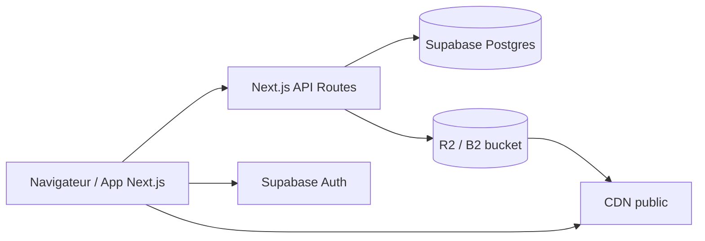

# Pixeo — Architecture cible

Frontend actuel : **Next.js 16 (App Router)** + React, état local (`localStorage`) pour la démo.  
Backend recommandé pour la production : **Supabase** (auth + Postgres) + **Cloudflare R2** ou **Backblaze B2** (photos).

## Vue d'ensemble

| Couche | Rôle |
|--------|------|
| Next.js | UI dashboard, galeries publiques `/c/[slug]`, API routes (`/api/health`, uploads signés, webhooks Stripe) |
| Supabase Auth | Email/mot de passe, JWT, RLS par `user_id` |
| Postgres | Métadonnées utilisateurs, plans, abonnements, galeries, photos |
| R2 / B2 | Fichiers originaux + dérivés (thumb, web) |
| Stripe (phase 2) | Abonnements FCFA, webhooks → table `subscriptions` |

## Schéma Postgres (recommandé)

### `users`
Extension du profil Supabase (`auth.users.id` = PK).

| Colonne | Type | Notes |
|---------|------|-------|
| `id` | uuid PK | = `auth.users.id` |
| `email` | text | dénormalisé pour admin |
| `name` | text | |
| `initials` | text | |
| `role` | text | `photographer` \| `platform_admin` |
| `status` | text | `active` \| `suspended` |
| `plan_id` | text FK → plans | plan courant (cache) |
| `branding_username` | text unique | sous-domaine / slug public |
| `storage_used_bytes` | bigint | agrégat |
| `created_at` | timestamptz | |
| `updated_at` | timestamptz | |

### `plans`
Catalogue éditable (admin Pixeo).

| Colonne | Type |
|---------|------|
| `id` | text PK (`free`, `starter`, `pro`, `studio`) |
| `name` | text |
| `price_monthly_fcfa` | int |
| `storage_limit_bytes` | bigint |
| `gallery_limit` | int nullable |
| `features` | jsonb |
| `active` | boolean |
| `sort_order` | int |

### `subscriptions`
Source de vérité billing (Stripe plus tard).

| Colonne | Type |
|---------|------|
| `id` | uuid PK |
| `user_id` | uuid FK → users |
| `plan_id` | text FK → plans |
| `status` | text |
| `current_period_start` | timestamptz |
| `current_period_end` | timestamptz |
| `cancel_at_period_end` | boolean |
| `stripe_customer_id` | text nullable |
| `stripe_subscription_id` | text nullable |

### `galleries`

| Colonne | Type |
|---------|------|
| `id` | uuid PK |
| `user_id` | uuid FK → users |
| `name` | text |
| `slug` | text |
| `status` | text |
| `cover_photo_id` | uuid nullable FK → photos |
| `cover_layout` | text |
| `cover_focal` | jsonb |
| `event_date` | date nullable |
| `password_hash` | text nullable |
| `client_exclusive` | boolean |
| `download_enabled` | boolean |
| `favorites_enabled` | boolean |
| `show_on_homepage` | boolean |
| `share_token` | text unique |
| `published_at` | timestamptz nullable |

Contrainte unique : `(user_id, slug)`.

### `gallery_sets`

| Colonne | Type |
|---------|------|
| `id` | uuid PK |
| `gallery_id` | uuid FK |
| `name` | text |
| `description` | text |
| `sort_order` | int |

### `photos`

| Colonne | Type |
|---------|------|
| `id` | uuid PK |
| `gallery_id` | uuid FK |
| `user_id` | uuid FK |
| `set_id` | uuid nullable FK |
| `name` | text |
| `storage_key` | text |
| `public_url` | text |
| `thumb_url` | text nullable |
| `size_bytes` | bigint |
| `width` | int nullable |
| `height` | int nullable |
| `sort_order` | int |

Index : `(gallery_id, sort_order)`, `(user_id)`.

### Tables auxiliaires (phase 2)
- `gallery_activities` — vues, téléchargements, favoris
- `billing_events` — historique factures
- `homepage_settings` — 1:1 avec `users`
- `branding_settings` — watermark, logo, domaine custom

## Row Level Security (Supabase)

- Photographe : CRUD sur ses lignes (`user_id = auth.uid()`).
- Public : lecture seule sur galeries `status = published` via RPC ou vue `public_galleries`.
- Admin : rôle `platform_admin` via claim JWT ou table `user_roles`.

## Upload photos (R2 / B2)

1. Client demande URL signée : `POST /api/photos/upload-url`.
2. Next vérifie quota storage + plan.
3. Upload direct navigateur → bucket (`/{userId}/{galleryId}/{photoId}.jpg`).
4. Webhook ou callback enregistre la ligne `photos` + met à jour `storage_used_bytes`.

Variables : voir `.env.example` (`R2_*` ou `B2_*`).

## Contrat API frontend

Types partagés dans `lib/api/types.ts`. Endpoints minimaux v1 :

| Méthode | Route | Description |
|---------|-------|-------------|
| GET | `/api/health` | Santé service |
| GET | `/api/galleries` | Liste (auth) |
| POST | `/api/galleries` | Créer |
| GET | `/api/galleries/[slug]/public` | Galerie publique |
| POST | `/api/photos/upload-url` | URL signée |
| PATCH | `/api/users/me/plan` | Changement plan (mock → Stripe) |

## Migration depuis la démo

1. Remplacer `lib/gallery-context.tsx` par hooks fetch + Supabase client.
2. Conserver les écrans ; mapper `AppState` → réponses API.
3. Seed : script SQL reprenant `lib/seed.ts` (comptes démo, galerie Yves).
4. Galeries publiques : SSR ou ISR sur `/c/[slug]` avec données serveur (pas `localStorage`).

## Déploiement

- **Vercel** : `next build` suffit ; pas de `vercel.json` obligatoire.
- Env : `NEXT_PUBLIC_APP_URL`, clés Supabase, R2.
- Domaine custom photographe : middleware + table `custom_domains`.
